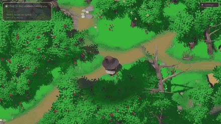
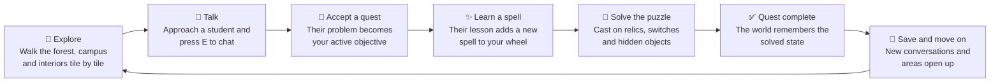
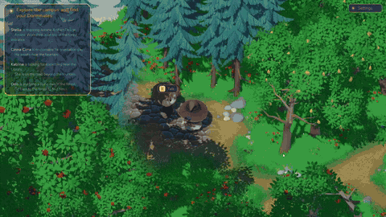
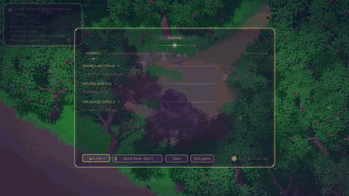
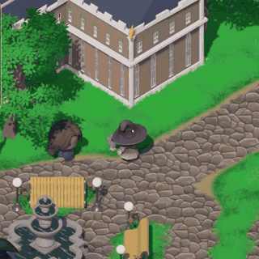
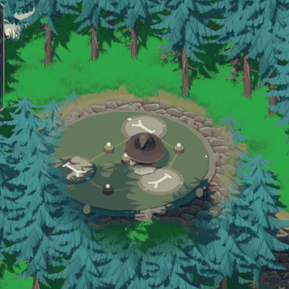
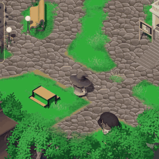
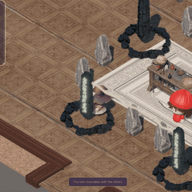
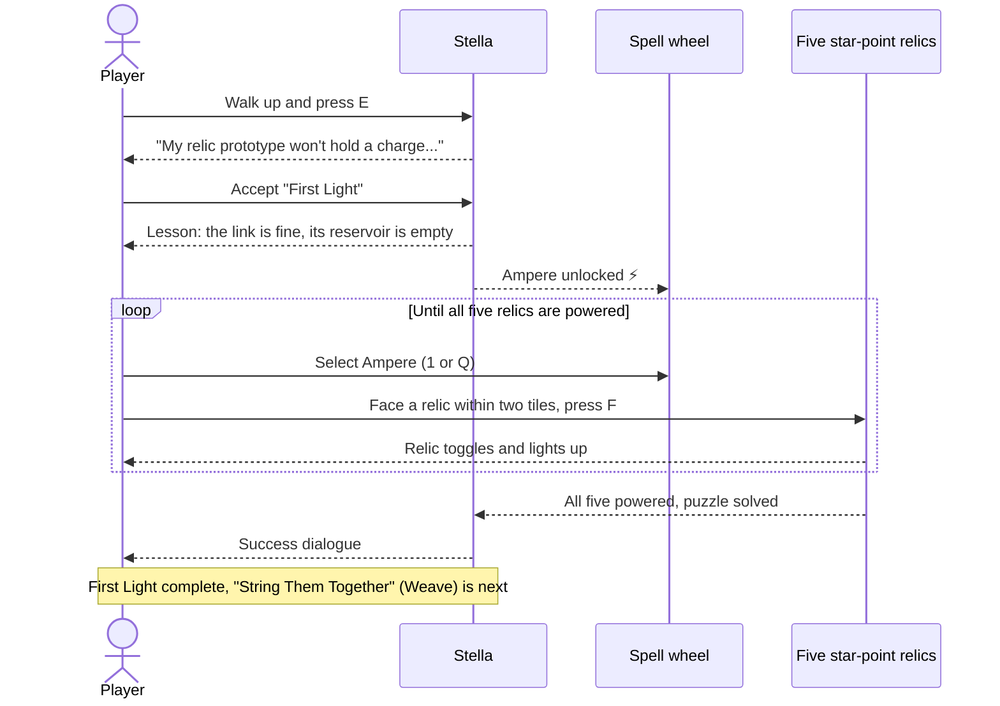

<div align="center">


# Lumenfall

**A cozy 2.5D, tile-based academy mystery where spells are puzzle tools.**

Arrive at a magical academy, befriend the students of the Sirius dormitory, and learn a new spell from each of them to solve hands-on puzzles, all while finding out who really has your dormitory key.

[**⬇ Download the latest Windows build**](https://github.com/Densetsu152637/Lumenfall-FIT3161/releases/latest) · [Design notes](docs) · [Implementation status](docs/implementation-status.md)

<sub>Unity 6000.4.10f1 · Windows x64 · FIT3161 project</sub>



</div>

---

## Contents

- [Play it](#play-it)
- [The gameplay loop](#the-gameplay-loop)
- [Example: one loop, start to finish](#example-one-loop-start-to-finish)
- [Spells](#spells)
- [Chapter 1 route](#chapter-1-route)
- [Controls](#controls)
- [For developers](#for-developers)

## Play it

1. Download the ZIP from the [latest release](https://github.com/Densetsu152637/Lumenfall-FIT3161/releases/latest).
2. Extract the **entire** archive. The executable needs the data folder next to it.
3. Run `Lumenfall.exe`, choose one of three save slots, and pick **New Game**.

Each successful build of `main` replaces the previous release bundle. See [CI and release instructions](.github/CI.md) for how builds are published.

## The gameplay loop

Every chapter beat follows the same rhythm: **meet someone, learn their spell, use it on the world, and unlock the next conversation.**



### See it in action

<table>
  <tr>
    <td width="50%" align="center"><br><sub><b>Talk:</b> Orio introduces his rune dais.</sub></td>
    <td width="50%" align="center"><br><sub><b>Save and continue:</b> pick up from any of three slots.</sub></td>
  </tr>
</table>
<table>
  <tr>
    <td width="33%" align="center"><br><sub><b>Vis:</b> lift and carry a relic.</sub></td>
    <td width="33%" align="center"><br><sub><b>Rotara:</b> turn the dais discs.</sub></td>
    <td width="33%" align="center"><br><sub><b>Lost Echoes:</b> uncover a hidden item.</sub></td>
  </tr>
</table>

What makes the loop work:

- **Grid movement.** You move one whole tile at a time, so puzzles are about positions and directions rather than reflexes. Hold Shift to sprint.
- **Spells change the world.** Spells change objects on the map: they power relics, string cables, slide blocks, rotate mechanisms, freeze floors, and reveal hidden things. Solved puzzles stay solved across map changes and save loads.
- **Hints when you want them.** An objective card points toward your current target and can suggest a next step. It can be switched off in Settings.
- **Three save slots.** Saves restore your map, tile, quests, dialogue progress and every puzzle object's state.

## Example: one loop, start to finish

Here is Stella's first quest, **First Light**, which teaches Ampere.

<p align="center">
  <br>
  <sub>Powered relics resonate with each other on Stella's board.</sub>
</p>



The same example, from the player's seat:

| # | You do | The game responds |
| ---: | --- | --- |
| 1 | Walk through campus to Stella's teaching room. | The quest hint card points the way. |
| 2 | Press **E** next to Stella. | Dialogue opens with her portrait. Movement and casting pause until it closes. |
| 3 | Choose to help. | **First Light** becomes an active quest in your journal (**Tab**). |
| 4 | Finish her lesson. | **Ampere** appears on your spell wheel. |
| 5 | Select Ampere, face a relic, and press **F** or right-click. | The relic toggles power and glows. Wrong targets give a short explanation. |
| 6 | Light all five relics. | The quest completes and Stella's success line plays. |
| 7 | Talk to Stella again. | Her next quest, **String Them Together**, teaches **Weave**. |

Later quests reuse this loop with new spells. You lift a relic with **Vis** and carry it through a portal, freeze a pool with **Glaciate** and slide across switches, turn rune discs with **Rotara**, and sweep an area with **Lost Echoes** to uncover lost keepsakes.

## Spells

Friends teach spells as part of their quests, so your toolkit grows as the chapter goes on. Open the wheel with **Q** or the middle mouse button, scroll to choose, or press **1–7** directly.

| | Spell | What it does in a puzzle |
| :---: | --- | --- |
|  | **Ampere** | Powers a compatible relic so it can drive a mechanism or a circuit. |
|  | **Weave** | Strings a cable between relics. Power flows through it, but it weakens over long distances. Cast again on a linked pair to cut the cable. |
|  | **Vis** | Lifts a relic so you can carry it, then sets it down on the tile you face or on its pedestal. |
|  | **Glaciate** | Freezes an object or a surface. Frozen things, including you on ice, slide until something stops them. |
|  | **Rotara** | Rotates a mechanism 90° per cast to bring it into alignment. |
|  | **Lost Echoes** | Sends out a sonar pulse. Hidden things nearby are revealed, and the echo's timing tells you how close something still is. |
|  | **Gravitate** | Nudges an object exactly one tile in a chosen direction. |

The full rules are in the [spell reference](docs/spells.md).

## Chapter 1 route

You arrive through the west forest with nowhere to sleep. The receptionist says your dormitory key was already handed to another student. Tracking it down introduces you to four dorm-mates, one quest at a time:

| Friend | Quest | Spell | The puzzle |
| --- | --- | --- | --- |
| **Stella** | First Light | Ampere | Power all five star-point relics on her engineering board. |
| **Stella** | String Them Together | Weave | Wire circuit relics into one connected, powered network. |
| **Cinna Cirra** | Out of Alignment | Vis | Lift an orientation relic, carry it into the ice trial, and set it on its pedestal. |
| **Cinna Cirra** | Cold Feet, Warm Idea | Glaciate | Freeze the trial pool and slide across it to light every switch, then the seal. |
| **Orio** | Patch Notes | Rotara | Turn the three rune discs of a deep-forest dais until they all point north. |
| **Katrina** | Something Borrowed | Lost Echoes | Search the campus for her hidden keepsakes. |

Meet the cast in [main-cast.md](docs/main-cast.md), explore the setting in [world.md](docs/world.md), and read quest details in [quests.md](docs/quests.md).

## Controls

Every key can be rebound in **Settings → Controls**.

| Action | Keyboard / mouse |
| --- | --- |
| Move | WASD or arrow keys |
| Sprint | Left Shift |
| Talk / pick up | E |
| Cast selected spell / interact | F or right mouse |
| Spell wheel | Q or middle mouse (scroll to choose) |
| Select spell directly | 1–7 |
| Journal (inventory, encyclopedia, settings) | Tab |
| Pause | Esc |

## For developers

### Getting started

Open [`Lumenfall`](Lumenfall) as the Unity project root with Unity `6000.4.10f1`. First-party content lives under [`Lumenfall/Assets/_Project`](Lumenfall/Assets/_Project) and authored runtime data under [`Lumenfall/Assets/Resources`](Lumenfall/Assets/Resources). Imported packages and Unity sample content are kept separately under `Assets/ThirdParty` and `Assets/Samples`.

### Repository guide

| Where | What |
| --- | --- |
| [`docs/`](docs) | Design notes covering the cast, quests, spells and world. They describe intended content, not implementation status. |
| [`docs/implementation-status.md`](docs/implementation-status.md) | Evidence-based status of each system and quest. |
| [`Systems/`](Lumenfall/Assets/_Project/Systems) | Feature-oriented runtime code, tests, documentation and owned data. |
| [Grid movement](Lumenfall/Assets/_Project/Systems/GridMovement/README.md) | Tile movement, reservations, pathfinding, portals and ice sliding. |
| [Game events](Lumenfall/Assets/_Project/Systems/GameEvents/README.md) | Events, dialogue, quest state and saves. |
| [Startup menu](Lumenfall/Assets/_Project/Systems/Startup/README.md) | Save slots, backdrop restoration, settings and input gating. |
| [Unity project guide](Lumenfall/README.md) | Project layout. |

### Building and testing

Compile the runtime and EditMode test assemblies without a licensed editor:

```powershell
powershell -ExecutionPolicy Bypass -File scripts/compile_runtime.ps1
powershell -ExecutionPolicy Bypass -File scripts/compile_editmode_tests.ps1
```

The [gameplay test suites](tests/README.md) run every EditMode and PlayMode regression case against the current project in a single Unity CI job. See [CI and release instructions](.github/CI.md) for the workflows.

## License

See [LICENSE](LICENSE). Third-party assets keep their own licences under `Lumenfall/Assets/ThirdParty`.
